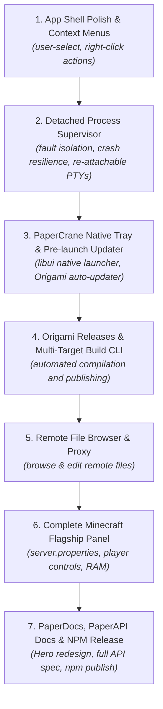

# Paperboard Development Roadmap

This roadmap outlines the path to finalizing the core desktop application, expanding flagship panels, building the native PaperCrane companion daemon and updater, and preparing the ecosystem for public documentation and npm release.

---

## 🗺️ Execution Phases

---

## Phase 1: Desktop Shell Polish & Context Menus *(Fast Win)*

- [ ] **Native App Feel (`user-select`)**:
  - Apply `user-select: none` across UI chrome (sidebars, headers, buttons, tab bars, modals).
  - Keep text selection explicitly enabled in terminal output, code snippets, and editable input fields.
- [ ] **Context Menus (`PaperContextMenu`)**:
  - **Sidebar Panels**:
    - Close Panel tab
    - Reload Panel iframe
    - Reveal Panel data directory
    - Uninstall Panel
  - **Terminal Tabs**:
    - Rename Tab
    - Clear Terminal Buffer
    - Duplicate Tab
    - Close / Terminate PTY Session

---

## Phase 2: Detached Process Supervisor *(Crash-Proof Running)*

- [x] **Headless Detached Process Runner**:
  - A lightweight supervisor that spawns processes independently from PaperCrane's main event loop.
  - Separate PID in OS Task Manager / Activity Monitor / `htop`.
- [x] **Persistent Re-attachable PTY / Socket Streaming**:
  - If PaperCrane updates, restarts, or crashes, background workloads (e.g., Minecraft server, bots, long-running scripts) **continue running undisturbed**.
  - On restart, PaperCrane discovers running supervisor sockets and re-attaches live terminal streams seamlessly.

---

## Phase 3: PaperCrane Native Tray & Pre-launch `libui` Updater

- [ ] **Native Pre-launch Splash & Updater (`libui`)**:
  - Opens instantly (<10MB memory, native Win32/Cocoa/GTK) before Electron launches.
  - Queries Origami for updates to Paperboard, PaperCrane, installed panels, and core packages.
  - Displays a clean native progress bar and updates binaries seamlessly.
- [ ] **PaperCrane System Tray / Menu Bar Utility**:
  - Windows: Native Win32 System Tray icon + status popup window.
  - macOS: Native Cocoa menu bar status item.
  - Linux: Native GTK status indicator.
- [ ] **System Startup Integration**:
  - Toggle to auto-start PaperCrane on system boot:
    - Windows: Registry `HKCU\Software\Microsoft\Windows\CurrentVersion\Run`
    - macOS: `launchd` plist (`~/Library/LaunchAgents`)
    - Linux: `systemd` user service / XDG autostart entry

---

## Phase 4: Origami Release Registry & Interactive Build CLI

- [ ] **Origami App & Daemon Release Feeds**:
  - Support versioning and binary asset distribution for `paperboard` and `papercrane` on Origami.
- [ ] **Interactive Multi-Target Build CLI (`bun run release`)**:
  - Interactive terminal CLI with checkbox selection for compile targets:
    - `paperboard` (Windows x64 zip/exe, macOS ARM64/x64 dmg/app, Linux AppImage/tar.gz)
    - `papercrane` (darwin-arm64, darwin-x64, linux-x64, win32-x64)
  - Automatically signs, checksums (SHA-256), and publishes binaries to Origami with one command.

---

## Phase 5: Remote File Browser & Proxy

- [ ] **"Open in File Explorer" Integration**:
  - **Local Computer**: Direct OS integration via `shell.openPath(serverDir)`.
  - **Remote Computer**: Opens an in-app file tree explorer powered by PaperCrane's `fileApi` over WebSocket/HTTP.
- [ ] **File Operations**:
  - In-app file viewer / text editor for configuration files (`.yml`, `.properties`, `.json`).
  - Remote file download / upload streaming.

---

## Phase 6: Complete Flagship Minecraft Panel (`dev.paperboard.gameserver`)

- [ ] **Visual `server.properties` Editor**:
  - Interactive toggles and fields for Difficulty, Gamemode, PVP, Max Players, Spawn Protection, Online Mode, and Whitelist.
  - Automatic hot-reloading and saving directly to `server.properties`.
- [ ] **RAM & JVM Configuration**:
  - UI sliders / inputs for minimum and maximum memory allocation (`-Xms`, `-Xmx`).
  - Custom JVM flags and Garbage Collector presets (Aikar flags).
- [ ] **Live Player Management**:
  - Real-time online player list tab with head avatars, latency/ping, and quick actions:
    - Kick Player
    - Ban Player / IP
    - Op / De-op
    - Teleport / Whisper commands
- [ ] **World Backups & Snapshot Management**:
  - One-click world backup zip creation and restoration.

---

## Phase 7: PaperDocs, PaperAPI Documentation & NPM Release

- [ ] **PaperDocs Landing Page Overhaul**:
  - Redesign the landing page with a modern hero section, interactive PaperUI live component playground, and feature showcase.
  - Complete the footer and navigation breadcrumbs.
- [ ] **Comprehensive `PaperAPI` Documentation**:
  - Document all namespaces:
    - `terminal` (`create`, `write`, `resize`, `destroy`, `onData`, `onExit`)
    - `files` (`read`, `write`, `getPath`, `clear`, `download`, `exists`)
    - `packages` (`isInstalled`, `getPath`, `download`, `getIndex`)
    - `process` (`run`)
    - `computers` (`list`, `getActive`, `setActive`, `onActiveChanged`)
    - `config` (`get`, `set`)
- [ ] **NPM Publishing**:
  - Finalize package metadata, READMEs, and TypeScript declarations.
  - Publish `@paperboard/paperui` and `@paperboard/paperapi` to npm.
